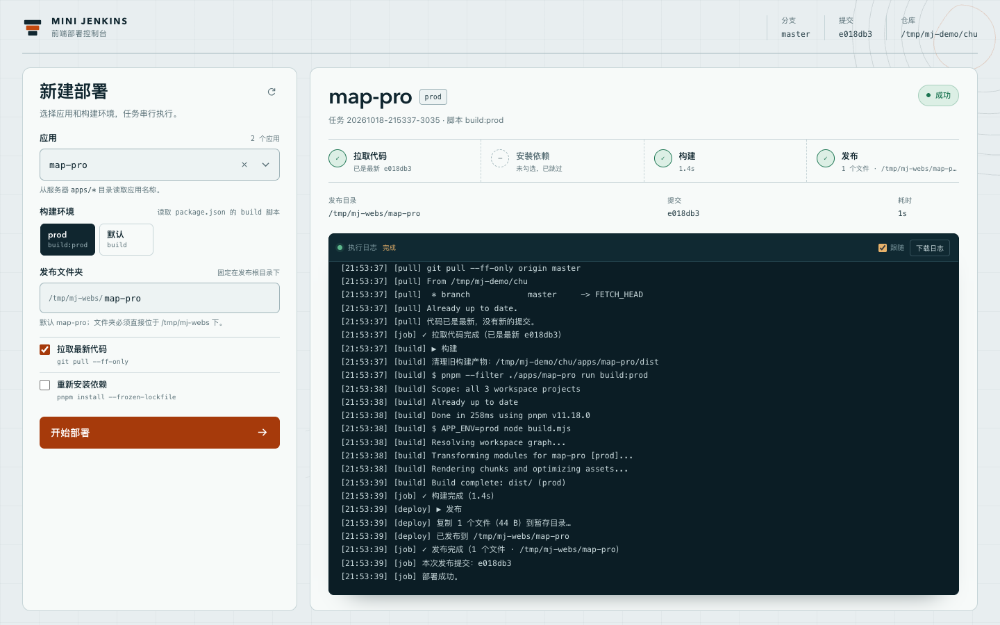
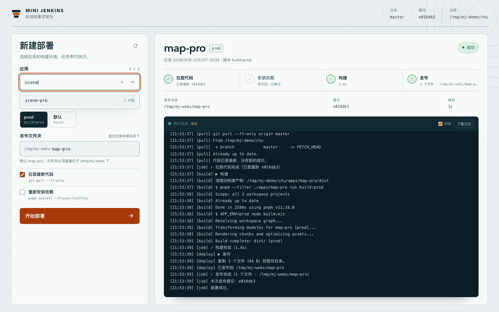
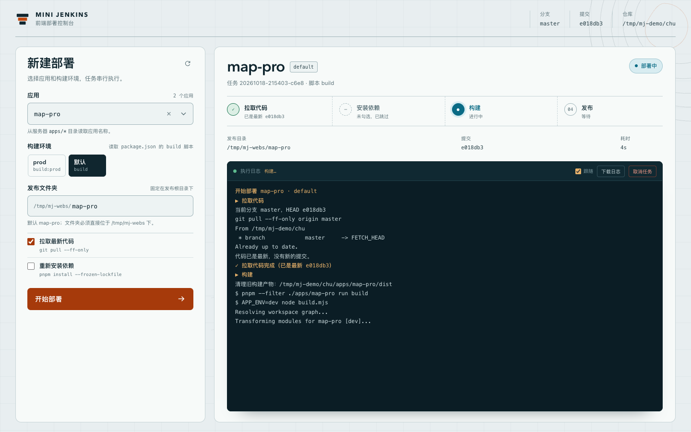
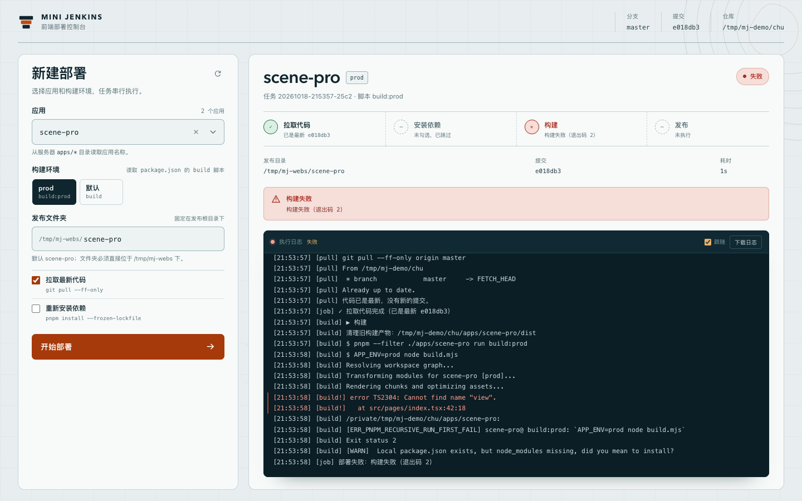
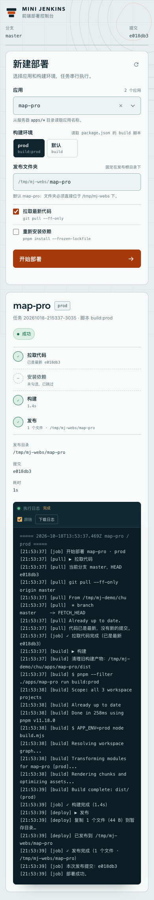

# mini-jenkins

一个给前端 pnpm monorepo 用的轻量单机部署控制台。选择应用和构建环境，服务器依次执行 **拉取代码 → 安装依赖（可选）→ 构建 → 发布**，浏览器通过 SSE 实时显示阶段和日志。



<details>
<summary>更多界面截图</summary>

**应用过滤与清空**



**构建中**



**构建失败**



**移动端**



</details>

## 特点

- 应用列表来自服务器上的 `repoPath/apps/*` 目录
- 应用下拉框支持输入过滤，打开时展示全部应用，带清空按钮
- 构建环境来自每个应用 `package.json` 里的 `build` / `build:<env>` 脚本
- 发布目录固定在 `deployRoot` 下，文件夹名可以在页面上修改，默认使用 app 名称
- 任务串行执行，支持排队、取消和重复任务拦截
- 实时阶段进度 + 实时日志；失败时显示失败阶段、退出码和错误输出
- 发布采用「暂存目录 + rename」切换，避免站点出现一半旧文件、一半新文件
- 无数据库、无历史记录、无日志落盘；任务和日志只存在当前进程内存中

## 为什么是轻量的

mini-jenkins 只保留当前正在使用的内容：

- 任务只保存在内存里，服务重启后清空
- 不保存历史部署记录
- 日志只保存在内存中，当前任务结束后仍可查看/下载；新任务开始或进程重启后释放
- 不创建 `data/`、`data/jobs.json` 或 `data/logs/`
- 没有用户体系，也没有登录/认证层

内存中最多保留：排队任务、运行中任务、最近完成的一个任务。单个任务日志最多保留最近 5000 行。

## 快速开始

### 服务器要求

- Node.js >= 24
- pnpm >= 11
- git
- 前端仓库已经 clone 到服务器，并且服务账号可以 `git pull`
- 一个可写的发布目录，例如 `/home/deploy/webs`

### 安装

```bash
cd /opt/mini-jenkins

cp config.example.json config.json
vi config.json                 # 修改 repoPath / deployRoot / branch

pnpm install --prod
pnpm start
```

默认访问 `http://127.0.0.1:3081`。生产环境建议只监听本机，通过 nginx 反向代理。

当前工作区的 `config.json` 已经指向本机 chu 仓库，`deployRoot` 是 `/tmp/mj-webs`，可以直接 `pnpm start` 预览。外网部署时请改回服务器路径，并自行限制访问来源。

### 本地预览

```bash
pnpm install
pnpm start
```

打开 `http://127.0.0.1:3081`。不点「开始部署」时只会读取应用列表和 Git 状态，不会构建或发布。

标题右侧的刷新按钮会重新读取 `apps/*`、构建脚本和 Git 状态，不需要重启进程。

## 配置

`config.json` 中的相对路径相对于配置文件所在目录解析。环境变量会覆盖同名配置。

```json
{
  "host": "127.0.0.1",
  "port": 3081,
  "repoPath": "/home/deploy/chu",
  "branch": "master",
  "remote": "origin",
  "appsDir": "apps",
  "deployRoot": "/home/deploy/webs",
  "pnpmBin": "pnpm",
  "installArgs": ["install", "--frozen-lockfile"],
  "requireClean": false,
  "pullTimeoutMinutes": 10,
  "buildTimeoutMinutes": 30
}
```

| 字段 | 默认值 | 说明 |
| --- | --- | --- |
| `host` | `127.0.0.1` | 监听地址 |
| `port` | `3081` | 监听端口 |
| `repoPath` | 必填 | 前端仓库路径 |
| `branch` | 当前分支 | 期望的部署分支；实际分支不一致时拉取会失败 |
| `remote` | `origin` | git remote 名称 |
| `appsDir` | `apps` | 相对仓库根目录的应用目录 |
| `deployRoot` | 必填 | 发布根目录 |
| `pnpmBin` | `pnpm` | pnpm 可执行文件；systemd 下建议写绝对路径 |
| `installArgs` | `["install","--frozen-lockfile"]` | 勾选「重新安装依赖」时执行的参数 |
| `requireClean` | `false` | 为 `true` 时工作区有未提交改动就停止拉取 |
| `pullTimeoutMinutes` | `10` | 拉取超时 |
| `buildTimeoutMinutes` | `30` | 安装依赖 / 构建超时 |

修改 `config.json` 或 `.env` 后需要重启进程。`apps/*` 和构建脚本在每次刷新/请求时重新读取，不需要重启。

### 环境变量

项目根目录的 `.env` 是可选的：如果存在，会在启动时自动读取，已存在的环境变量不会被覆盖。所有变量都只是对 `config.json` 的覆盖，不涉及账号或密码。

| 变量 | 说明 |
| --- | --- |
| `MINI_JENKINS_HOST` / `MINI_JENKINS_PORT` | 覆盖监听地址 / 端口 |
| `MINI_JENKINS_REPO_PATH` / `MINI_JENKINS_DEPLOY_ROOT` | 覆盖仓库 / 发布目录 |
| `MINI_JENKINS_BRANCH` / `MINI_JENKINS_REMOTE` | 覆盖分支 / remote |
| `MINI_JENKINS_PNPM` | 覆盖 pnpm 路径 |
| `MINI_JENKINS_REQUIRE_CLEAN` | 覆盖 `requireClean` |
| `MINI_JENKINS_CONFIG` | 指定另一个配置文件路径 |

## 应用、构建环境和发布目录

### 应用

启动后读取 `repoPath/apps/*` 的目录名作为应用列表：

- 目录名就是应用名
- 有可解析 `package.json` 的应用会读取其中的构建脚本
- 没有 `package.json` 或没有可用 build 脚本的目录仍会出现在下拉框中，标记为「无构建脚本」

应用下拉框可以直接输入过滤，打开时展示全部应用；右侧的 `×` 用于清空过滤词并重新展示全部应用。

### 构建环境

每个应用的构建环境来自 `package.json` 的 `scripts`：

- `build` → 显示为「默认」
- `build:prod`、`build:test`、`build:jn` → 显示为 `prod`、`test`、`jn`

默认优先选择 `prod`；没有 `prod` 时选择「默认」。实际执行：

```bash
pnpm --filter ./apps/<app> run <script>
```

「环境」指的是构建脚本变体（通常通过 `APP_ENV` 注入不同配置），不是页面上临时输入的任意环境变量。需要新环境时，在应用的 `package.json` 里增加对应的 `build:<name>` 脚本即可。

### 发布目录

发布路径始终是：

```text
<deployRoot>/<发布文件夹名>
```

- 文件夹名可以在页面上修改
- 默认使用 app 名称
- 必须直接位于 `deployRoot` 下，不能包含 `/`、`..` 等路径片段
- 只允许字母、数字、点、下划线和连字符，且不能以点开头，最长 100 个字符
- 服务端会再次校验，非法目录返回 400

## 部署流程

1. **拉取代码**：`git pull --ff-only --no-rebase <remote> <branch>`
   - 当前分支与配置不一致时直接失败
   - 工作区有未提交改动时会警告；设置 `requireClean` 后直接失败
2. **安装依赖**（可选）：在仓库根目录执行 `pnpm install --frozen-lockfile`
   - 默认不勾选
   - 拉取到 lockfile 变更但未勾选时，日志会提示
3. **构建**：
   - 先删除 `apps/<app>/dist`
   - 执行对应构建脚本
   - 超时或退出码非 0 会标记失败
4. **发布**：
   - 检查 `dist` 是否存在且非空
   - 复制到 `deployRoot/.<target>.staging-<jobId>`
   - 旧目录改名为 `.<target>.old-<jobId>`
   - 暂存目录 rename 为正式目录
   - 删除旧目录

任务全局串行：一个任务运行时，新任务进入队列；同一 app + 环境 + 发布目录已有排队/运行任务时拒绝重复提交。运行中的任务可以取消：先 SIGTERM，5 秒后 SIGKILL。

构建子进程会继承服务器的 PATH、HOME 等环境，但会移除所有 `MINI_JENKINS_*` 变量，避免构建脚本读到控制台的配置变量。

## 运行状态与日志

- 任务状态保存在内存中，不写入磁盘
- 日志保存在内存中，单个任务最多 5000 行
- 界面最多渲染最近 3000 行；下载日志接口返回内存中保留的内容
- 服务重启后任务和日志全部清空
- 刷新页面时，如果后台有正在运行的任务，会自动接回当前任务
- 已结束的任务不提供历史恢复；新任务开始后会释放上一个已完成任务

## 部署安全

这个工具没有登录、账号或认证层。任何能访问端口的人都可以读取应用列表并触发部署。

- 默认只监听 `127.0.0.1`，建议通过 nginx 反向代理
- 不要把 `3081` 直接暴露到公网
- 用内网、防火墙、VPN 或 nginx 的 `allow` / `deny` 限制访问来源
- 对公网入口使用 HTTPS
- 写操作要求 JSON 请求体并做同源校验
- 应用名、环境名和发布文件夹名都经过白名单或路径校验，不会把用户输入拼进 shell 命令

## systemd

参考 [`deploy/mini-jenkins.service`](deploy/mini-jenkins.service)：

```bash
sudo cp deploy/mini-jenkins.service /etc/systemd/system/mini-jenkins.service
sudo vi /etc/systemd/system/mini-jenkins.service
# 修改 WorkingDirectory、ExecStart、PATH
# 按需设置 User / Group / HOME

sudo systemctl daemon-reload
sudo systemctl enable --now mini-jenkins
sudo systemctl status mini-jenkins
sudo journalctl -u mini-jenkins -f
```

如果 Node 通过 nvm 安装，systemd 不会自动加载 shell 的 PATH，需要写 node 的绝对路径，并建议把 `config.json` 的 `pnpmBin` 也改成 pnpm 的绝对路径。

服务账号需要有权限读写 `repoPath` 和 `deployRoot`；nginx 运行用户需要能读取发布目录。

## nginx

参考 [`deploy/nginx.conf`](deploy/nginx.conf)：

```nginx
location / {
    proxy_pass http://127.0.0.1:3081;
    proxy_http_version 1.1;

    proxy_set_header Host $http_host;
    proxy_set_header X-Real-IP $remote_addr;
    proxy_set_header X-Forwarded-For $proxy_add_x_forwarded_for;
    proxy_set_header X-Forwarded-Proto $scheme;
    proxy_set_header X-Forwarded-Host $http_host;

    proxy_buffering off;
    proxy_cache off;
    proxy_read_timeout 3600s;
    proxy_send_timeout 3600s;
}
```

`proxy_buffering off` 是 SSE 实时日志能逐行出现的关键；`X-Forwarded-Host` 用于同源校验。

## HTTP API

所有接口都没有认证，请自行限制访问来源。

| 方法与路径 | 说明 |
| --- | --- |
| `GET /api/health` | 健康检查 |
| `GET /api/meta` | 应用列表、构建环境、发布根目录、Git 状态、当前运行任务 ID |
| `POST /api/jobs` | 创建任务 |
| `GET /api/jobs/:id` | 当前任务详情 |
| `GET /api/jobs/:id/events` | SSE 事件流：`snapshot` / `log` / `end` |
| `GET /api/jobs/:id/log` | 内存中的日志文本 |
| `POST /api/jobs/:id/cancel` | 取消排队中或运行中的任务 |

创建任务示例：

```bash
curl \
  -H 'Content-Type: application/json' \
  -d '{"app":"map-pro","variant":"prod","targetName":"map-pro","pull":true,"install":false}' \
  http://127.0.0.1:3081/api/jobs
```

`targetName` 可省略，省略时使用 app 名称。

## 本地开发与测试

```bash
pnpm install
pnpm start
pnpm test
```

前端是原生 ES Modules + CSS，没有构建步骤；修改 `public/` 后刷新页面即可。后端依赖只有 Express。

测试会在系统临时目录里创建一个带 bare remote 的 pnpm monorepo，真实执行 `git pull`、pnpm 构建、目录切换和 HTTP/SSE 请求，覆盖：

- 应用发现和构建环境解析
- 自定义发布文件夹与路径穿越拦截
- 成功部署、重新拉取新提交
- 构建失败、失败阶段和日志
- 串行队列、排队任务、取消
- 跨站 POST 拒绝

## 目录结构

```text
src/
├── server.js          # 启动入口、优雅退出
├── app.js             # Express 路由、SSE、静态资源、同源校验
├── security.js        # 同源校验
├── config.js          # 配置加载与校验、.env 读取
├── discovery.js       # 发现 apps/*、构建变体、发布目录校验
├── git.js             # git 状态、快进拉取
├── runner.js          # 子进程执行、日志分行、超时/取消
├── deploy-runner.js   # 拉取 → 安装 → 构建 → 发布
├── publisher.js       # 暂存 + rename 发布
├── job-manager.js     # 内存任务、队列、SSE、取消、日志缓冲
├── job-status.js      # 任务状态判断
public/
├── index.html
├── styles.css
├── contours.svg
├── favicon.svg
└── js/                # app / ui / api / format
deploy/
├── nginx.conf
└── mini-jenkins.service
test/
docs/
```
